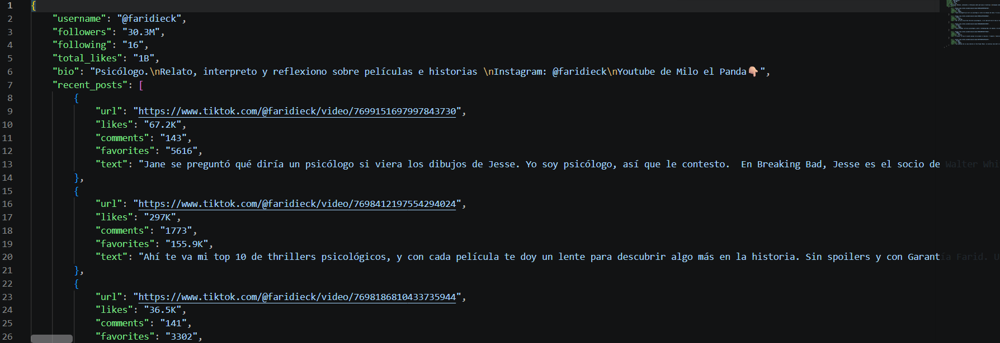
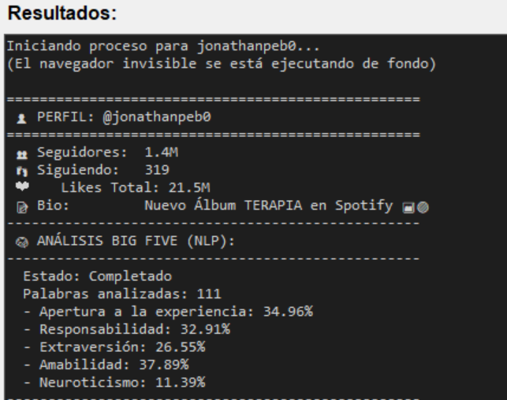

## 📸 Resumen del Proyecto: TikTok Scraper & Big Five NLP Profiler

Una mirada rápida a la herramienta en acción:

### 1. Interfaz Gráfica Integrada (Scraping + NLP)

*Panel de control intuitivo desarrollado en Tkinter para ingresar el usuario, gestionar la sesión de cookies y controlar el proceso de extracción.*

### 2. Estructura de Datos (Exportación JSON)

*Consolidación automatizada de las métricas del perfil, información biográfica y el corpus de texto de las últimas publicaciones listos para la ingesta de datos.*

### 3. Clasificación Psicológica (Modelo Big Five)

*Evaluación semántica Zero-Shot utilizando embeddings de Hugging Face. El sistema procesa el corpus de texto del creador, superando un umbral de validación, y calcula la similitud matemática contra anclajes psicológicos para puntuar los rasgos de Apertura, Responsabilidad, Extraversión, Amabilidad y Neuroticismo.*